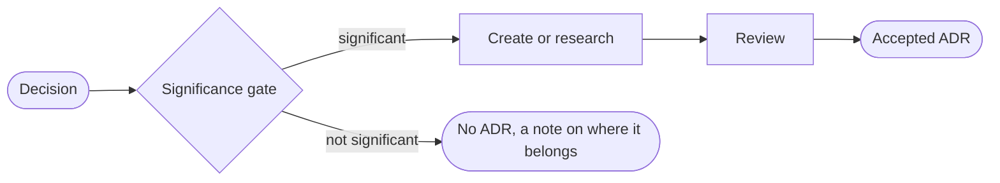

<p align="center">
  
</p>

<h1 align="center">Human Lead Architect</h1>

<p align="center">
  <b>Skills for the distinguished software architect.</b><br>
  <i>The architect leads. The AI does the legwork.</i>
</p>

<p align="center">
  <a href="#-getting-started">Getting started</a> ·
  <a href="#-what-is-an-adr">What is an ADR?</a> ·
  <a href="#-principles">Principles</a> ·
  <a href="#-skills">Skills</a>
</p>

<p align="center">
  
  
  
  
</p>

<p align="center">
  <a href="https://github.com/kamilbaczek/AI-Human-Lead-Solution-Architecture/actions/workflows/plugin-ci.yml"></a>
</p>

<hr>

<div align="center">

> ### 💬 *"Why" is more important than "How".*
>
> Anyone can describe what was built. An architect preserves the reasoning,
> so the next team can tell whether the decision still holds.
>
> **— Neal Ford & Mark Richards**, *Fundamentals of Software Architecture* (the Second Law)

> ### 💬 *An ADR records a significant decision: one that is hard to revert.*
>
> Significance is measured by how hard it is to undo. If one pull request can reverse it,
> it is not an architecture decision and it does not get an ADR.
>
> **— Grady Booch**

</div>

<table align="center">
  <tr>
    <td align="center" width="25%"><h3>✍️</h3><b>Create</b><br><sub>ADR from a decision you already have</sub></td>
    <td align="center" width="25%"><h3>🔎</h3><b>Research</b><br><sub>Evidence first, draft second</sub></td>
    <td align="center" width="25%"><h3>🧠</h3><b>Challenge</b><br><sub>Is the decision actually sound?</sub></td>
    <td align="center" width="25%"><h3>✅</h3><b>Review</b><br><sub>Checklist and gap-filling interview</sub></td>
  </tr>
</table>

## About

You have a decision to make. It will be expensive to undo, and in a year nobody will remember why the team chose it. That is the problem an ADR solves. It is also why most teams stop writing them: a good ADR needs research, trade-off analysis and a review round, and that takes time.

What we cover:

* Creating an ADR from a decision you already have
* Researching the evidence behind a decision before you draft
* Challenging and reviewing an ADR before the team accepts it

What we leave to you:

* The decision itself
* The conversation with your team about it

## 📖 What is an ADR?

An **Architecture Decision Record** (ADR) captures 1 significant decision: the context that forced it, the options we considered, the choice we made, and the consequences we accept.

| Section | The question it answers |
| --- | --- |
| **Context** | Why do we have to decide this now? What forces are at play? |
| **Options** | What else could we have done, and what does each cost? |
| **Decision** | What did we choose, and why this one over the others? |
| **Consequences** | What gets easier, what gets harder, and what risks do we now carry? |

The team writes an ADR for the team. People debate it in review, challenge the trade-offs and record the outcome. A new engineer who joins a year later can read *why* before changing *how*.

## 🧭 Principles

We follow 4 principles when we write and review ADRs.

| Principle | What it means in practice |
| --- | --- |
| ⚖️ **Trade-off analysis** | Every option has a cost. We compare real alternatives and write down what you give up, not only what you gain. |
| 🎯 **Risk-driven decisions** | We spend effort where the risk is. The harder a decision is to reverse, the more evidence it needs. |
| 🤝 **Collaborative decisions** | The team owns the decision. The skills ask questions and point out gaps. They never decide for you. |
| 🚪 **Significance gate** | A cosmetic, local or 1-PR-reversible choice gets turned away, so your ADR log stays worth reading. |

## 🚀 Getting started

You need the [Claude Code](https://claude.com/claude-code) CLI and Node.js 18+.

The fastest path is 1 command, straight from GitHub:

```bash
npx github:kamilbaczek/AI-Human-Lead-Solution-Architecture
```

It runs the 2 commands below for you. If you prefer to see each step, run them yourself:

```bash
claude plugin marketplace add kamilbaczek/AI-Human-Lead-Solution-Architecture
claude plugin install human-lead-architect@ai-human-lead-solution-architecture
```

### Updating

Already installed an earlier version? Refresh the marketplace and update the plugin, then restart Claude Code:

```bash
claude plugin marketplace update ai-human-lead-solution-architecture
claude plugin update human-lead-architect@ai-human-lead-solution-architecture
```

> **Note:** If `marketplace add` fails with "its source doesn't match its `extraKnownMarketplaces` entry", an older entry in `~/.claude/settings.json` points at a different repo. Change its `repo` to `kamilbaczek/AI-Human-Lead-Solution-Architecture` and run the command again.

## 🧰 Skills

Which skill do you need? It depends on how much you already know. Start with `adr-create` if you know the decision, `adr-research-draft` if you need facts first, then run `adr-review` before the team accepts it. Later, use `adr-supersede`, `adr-index-check` and `adr-drift-check` to keep the log honest.

| Skill | Use it when | What it does |
| --- | --- | --- |
| ✍️ [`adr-create`](plugins/human-lead-architect/skills/adr-create/SKILL.md) | You already know the decision | Turns your decision into a complete ADR: real alternatives, a trade-off matrix, consequences and follow-ups. It numbers the file to match your ADR folder and checks the draft against a checklist before saving |
| 🔎 [`adr-research-draft`](plugins/human-lead-architect/skills/adr-research-draft/SKILL.md) | The decision needs evidence you don't have | Reads your codebase and existing ADRs, collects at least 3 sources per option, and marks each claim with a confidence level. You get an ADR built on evidence, not on opinion |
| ✅ [`adr-review`](plugins/human-lead-architect/skills/adr-review/SKILL.md) | You want an ADR checked before the team accepts it | Gives a verdict (Accept, Revise or Reject), ranks every issue as blocking, required or suggested, and checks trade-offs, reversibility and a checklist with REST API and database checks. Then it interviews you question by question to fill the gaps |
| 🔁 [`adr-supersede`](plugins/human-lead-architect/skills/adr-supersede/SKILL.md) | A decision is being replaced | Marks the old ADR as superseded, checks the new one explains why the old decision no longer holds, and lists every reference to update. The old ADR's body is never rewritten |
| 🩺 [`adr-index-check`](plugins/human-lead-architect/skills/adr-index-check/SKILL.md) | You want the whole ADR log checked | Finds numbering gaps, duplicates, broken supersede links and stale Proposed ADRs across the log. It only reports and never edits |
| 🧭 [`adr-drift-check`](plugins/human-lead-architect/skills/adr-drift-check/SKILL.md) | You suspect the code ignores an ADR | Checks each claim in an accepted ADR against the code and marks it followed, drifted, partial or unverifiable, with the file as evidence |

### The flow

Every request goes through the significance gate first. If the decision fails it, we stop and tell you where it belongs instead.



> **Note:** The gate says no on purpose. An ADR log full of small choices hides the few decisions that matter.

## 🗂️ Project structure

```text
AI-Human-Lead-Solution-Architecture/
  bin/
    install.js        # npx installer
  .claude-plugin/
    marketplace.json
  package.json
  plugins/
    human-lead-architect/
      .claude-plugin/
        plugin.json
      agents/
        adr-reviewer.md
      skills/
        adr-create/
        adr-research-draft/
        adr-review/
        adr-supersede/
        adr-index-check/
        adr-drift-check/
      shared/         # ADR template, significance gate, checklists
```

## License

[MIT](LICENSE)
